# Pixel Sweep



<details>
<summary>Day mode</summary>



</details>

A calm theme for the Claude desktop and mobile apps. The night version is near-black with dim green pixel islands at the edges of the chat column; every 28 seconds a soft light band passes slowly across them. The day version is cool pale paper with soft blue pixels and an ink-blue accent for links and commands. The pixel art is generated and kept away from the middle of the window and the message box, so it stays out of the way of reading and typing.

- Text contrast: primary text at 16:1 or more, muted text at 5.8:1 or more, in both modes.
- Motion: only transform and opacity animate; the scene stops moving when the system asks for reduced motion.
- Panels stay solid, so the scene shows only behind the conversation.

## Install

At the prompt of a Claude Code terminal session:

```
/plugin install pixel-sweep-look --marketplace maksimTrs/pixel-sweep-look
```

Answer `y` to add the marketplace, then pick a scope.

From a shell:

```
claude plugin install pixel-sweep-look --marketplace maksimTrs/pixel-sweep-look
```

In the desktop app, where `/plugin` does not run: click **+** next to the prompt box, then **Plugins**, **Add marketplace** with `maksimTrs/pixel-sweep-look`, then **Add plugin**.

The theme applies when a new session starts. Terminals and editors draw no theme.

## License

MIT, see [LICENSE](LICENSE).
